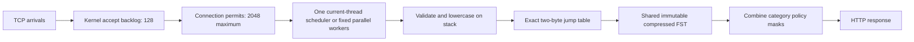

# Dataflow optimization research and experiment log — 2026-11-06

This records the earlier prefix-table/runtime checkpoint. The later
[packed-policy and selected-source work](packed-policy-optimization.md) adds
adaptive snapshot formats, new comparisons, and a SQLite batching experiment.

The query path is HTTP parsing → category/name validation → lowercase hostname
on the stack → reversed-name FST traversal → policy masks → JSON response.
Matching already has no database I/O, mutex, heap allocation or probabilistic
decision. HTTP parsing, connection/task state and response formatting still
allocate. Upstream DNS, database logging and UI are not part of this prototype.

The earlier capped run had matcher p99 around 10 microseconds and HTTP p99 around
33 milliseconds. These percentiles cannot be subtracted to produce an overhead
distribution, but the gap makes transport, scheduling and load-generator behavior
important investigation targets. Generator and server share a laptop; an HTTP
load result cannot isolate library overhead by itself. No hardware sampling
profile is claimed: `perf` is not installed in this environment.

## Research and decisions

| Evidence | Relevant idea | Decision for this iteration |
| --- | --- | --- |
| [SuRF / Fast Succinct Trie, SIGMOD 2018](https://www.cs.cmu.edu/~huanche1/publications/surf_paper.pdf) | Dense upper trie levels and compact lower levels trade a small amount of space for faster navigation. | Test a bounded two-byte transition table over the existing exact transducer. This is inspired by the layout principle, not an implementation of SuRF. |
| [Fast Compressed Tries through Path Decompositions](https://arxiv.org/abs/1111.5220) | String layout and path decomposition can improve space and memory latency. | Consider a future format experiment; avoid changing the snapshot before a measured benefit and migration tests. |
| [C²: Cache-Conscious Succinct Tries, June 2026](https://arxiv.org/abs/2606.16104) | Cache locality and unary-path compression matter in succinct dictionaries. | Research candidate, not a drop-in Rust library or a verified speedup on DNS data. |
| [ART, ICDE 2013](https://db.in.tum.de/~leis/papers/ART.pdf) | Adaptive node representations support fast in-memory indexing. | A potential mutable override index; a full replacement must first beat the existing 1.89 MB snapshot on exact suffix/category semantics. No local ART benchmark yet. |
| [Binary Fuse Filters](https://arxiv.org/abs/2201.01174) | Fast compact approximate membership. | Do not use a positive result as a block decision. A negative prefilter must cover every eligible suffix and still retain the exact index; added hashes/storage need a separate measured justification. |
| [Rust forum: Tokio versus Actix performance](https://users.rust-lang.org/t/getting-tokio-to-match-actix-web-performance/18659) | Original experiment suggests executor topology can matter. | Treat this old, different-version benchmark as a hypothesis only. Compare current-thread versus one-worker work-stealing locally. |
| [Tokio 1.48 runtime documentation](https://docs.rs/tokio/1.48.0/tokio/runtime/index.html) | Current-thread and multi-thread schedulers use different queues and wakeup paths. | Keep parallel workers available, but test a current-thread runtime when only one worker is requested. |
| [Hyper idle-buffer proposal #4240](https://github.com/hyperium/hyper/issues/4240) | Idle connections retain read/write buffers; a buffer-provider design is proposed. | It is an open proposal, not a shipped memory saving. Bound connections and buffers now. |
| [Hyper 1.12 release](https://github.com/hyperium/hyper/releases/tag/v1.12.0) | Header size controls and HTTP correctness changes; release history includes buffer enforcement and CPU fixes. | Evaluate an upgrade independently. Do not claim every fix affects this workload. |
| [The `fst` author's design and experiments](https://burntsushi.net/transducers/) | Compact automata provide exact ordered string maps. | Preserve the existing format and mature decoder while testing a small derived acceleration structure. |
| [Glommio](https://github.com/DataDog/glommio) | Linux/io_uring, cooperative thread-per-core execution. | Not selected as the sole runtime because this product also needs Windows/macOS. No local performance claim. |
| [Monoio](https://github.com/monoio-rs/monoio) | Owned-buffer I/O and thread-per-core execution; its README describes Windows support as experimental. | Not a replacement for the current portable baseline without platform and protocol qualification. |
| [Compio](https://github.com/compio-rs/compio) | Completion-based I/O with IOCP/io_uring/polling and thread-per-core execution. | Credible future comparison once real DNS transport exists. No measured reason yet to replace Tokio and change I/O integration. |

“FST” in the SuRF paper means **Fast Succinct Trie**, not the finite-state
transducer implemented by Rust's `fst` crate. Their implementations and benchmark
claims are not interchangeable. The cited papers motivate experiments; their
published multipliers are not performance claims for this application.

## Candidate: exact two-byte prefix table

At load time, cache the destination and accumulated output of the first two
reversed hostname bytes. There are 36 legal final characters and 37 legal
non-dot preceding characters: 1,332 entries × 8 bytes = **10,656 bytes per
present scope/action kind**, at most 95,904 table bytes for nine kinds, plus
small array metadata. The real block-list corpus has one kind. The serialized
index is unchanged. Addresses/output are packed losslessly; oversized indexes
fall back to the scalar traversal rather than truncating an address.

A zero slot is an exact missing transition, not a hash/Bloom approximation.
Short names and one-character suffix boundaries use scalar handling. The
destination's final state is still checked, so two-character suffix rules are
not skipped. After the jump, normal FST traversal handles all remaining bytes.
There are no per-query writes, allocations, evictions or cache locks.

Tests were added first and failed because the table/API was absent. Coverage
compares all 1,332 table slots against two real FST transitions and checks all
128 enabled-category masks against an independent policy oracle for short
suffixes, exact/domain/subdomain rules and all three actions. Existing allocation,
concurrency, snapshot, normalization and policy tests remain required.

## Measurement plan

Save the original binaries, alternate before/after direct-engine runs with the
same index and 12,000-case fixture, and record hashes, p50/p95/p99 and sizes.
Only after compilation finishes, compare HTTP variants under identical cgroup
budgets, worker/VU counts and k6 settings. Keep failed thresholds and rejected
variants. A bounded socket queue is backpressure, not extra achieved capacity;
CPU parallelism stays explicit and does not duplicate the index.

The accept backlog is subject to operating-system queue semantics and limits;
it is not a user-space queue promising acceptance of exactly 128 requests.
One task owns each admitted connection. There is no additional per-lookup
producer/consumer hop: these jobs are short, and every added hop would require
measurement to justify its scheduling cost. At the active-connection ceiling,
the accept loop waits for a permit. More clients may wait or fail to connect;
the queue does not create capacity. The 2,048 connection ceiling also does not
guarantee that 2,048 buffered HTTP connections fit in an 8 MiB cgroup. The kernel
memory ceiling remains the final limit. DNS clients will not require one HTTP
connection each.

## Direct matcher comparison

Six alternating pairs were run twice: once with normal scheduler placement,
then with both variants pinned to logical CPU 7 (not isolated). Each run warmed
the same 178,507-rule index and timed 120,000 lookups over the same 12,000 queries.
Each executable first verified the expected blocked masks. The new oracle and
allocation tests cover the broader policy contract separately.

| Experiment | Variant | Median run p50 | Median run p95 | Median run p99 |
| --- | --- | ---: | ---: | ---: |
| Unpinned | Original | 3.295 µs | 6.715 µs | 9.685 µs |
| Unpinned | Prefix table | 2.831 µs | 6.099 µs | 8.631 µs |
| CPU 7 | Original | 3.699 µs | 7.734 µs | 11.734 µs |
| CPU 7 | Prefix table | 3.238 µs | 7.192 µs | 11.368 µs |

Median lookup latency decreased **14.08%** and **12.45%**, respectively. The p99
change was smaller and less consistent: **10.88%** and **3.12%**. Individual runs
were noisy; these are median-of-run measurements, not confidence intervals or
an assertion that every query improves. The extra table bytes are bounded and
the persisted index is unchanged, so the prefix table is retained.

Raw timings and executable/corpus hashes:
[unpinned](benchmarks/dataflow-microbench.json), [CPU 7](benchmarks/dataflow-microbench-pinned.json).

## HTTP comparison and parallel workers

The order was original → prefix → scheduler/queue → Hyper 1.12, then reversed.
Every row used a 30-second arrival phase, 200 VUs, the same corpus, 8 MiB charged
memory, no swap and 50% of one logical CPU. Builds and other project benchmarks
were stopped. All rows had zero HTTP/policy response errors and no OOM kill;
dropped arrivals and p99 gate failures remain failures.

| Variant | Workers | Target/sec | Handled/sec¹ | HTTP p99 ms | Mean server CPU | Peak RSS MiB | Drops |
| --- | ---: | ---: | ---: | ---: | ---: | ---: | ---: |
| Original | 1 | 2,500 | 1,943.43 | 187.832 | 16.37% | 6.41 | 16,559 |
| Prefix only | 1 | 2,500 | 1,946.47 | 197.023 | 15.51% | 6.64 | 16,564 |
| Scheduler/queue, Hyper 1.7 | 1 | 2,500 | 2,215.47 | 153.385 | 15.42% | 6.46 | 8,532 |
| Scheduler/queue, Hyper 1.12 | 1 | 2,500 | 2,500.00 | 7.345 | 14.99% | 6.51 | 0 |
| Scheduler/queue, Hyper 1.12 | 1 | 2,500 | 2,500.03 | 10.457 | 14.93% | 6.64 | 0 |
| Scheduler/queue, Hyper 1.7 | 1 | 2,500 | 2,485.10 | 36.771 | 16.95% | 6.65 | 446 |
| Prefix only | 1 | 2,500 | 2,481.37 | 55.194 | 19.99% | 7.46 | 560 |
| Original | 1 | 2,500 | 2,490.27 | 39.208 | 18.20% | 6.75 | 291 |
| Scheduler/queue, Hyper 1.12 | 1 | 25,000 | 2,387.10 | 115.697 | 18.70% | 6.64 | 613,274 |
| Scheduler/queue, Hyper 1.12 | 2 | 25,000 | 3,709.40 | 82.575 | 23.02% | 6.78 | 638,082 |

¹ Correct responses divided by the configured arrival duration, including any
responses drained after arrivals stop. The separate k6 overall rate, including
setup, is retained in [full reports](benchmarks/dataflow-http-results.json). Process CPU/RSS
sampling also includes setup and k6 summary generation. CPU 100% = one logical CPU.

The full updated build passed both 2,500/sec screens. The other variants did not
pass both gates in these conditions. However, the original itself improved
substantially by the second run, demonstrating host drift. Do not turn this
table into a claimed 90% library speedup. Two workers handled more high-load
requests in the exploratory screen, but that unpaired observation is not proof
of a causal parallelism gain. Both 25,000/sec tests failed capacity.

Retain Hyper 1.12, the bounded queue and explicit worker choice. The async
adapter with one worker is now the runner default; the blocking adapter remains
available for comparisons via `--server`. More workers are opt-in with `--workers`;
the library/index is shared, not copied. No runtime has been declared generally
faster than its alternatives on the basis of these laptop screens.

## Size and validation

| Artifact | Before | Selected build |
| --- | ---: | ---: |
| Production CLI | 400,296 bytes | 406,928 bytes |
| Async test executable | 725,264 bytes | 736,752 bytes |
| Real policy snapshot | 1,889,139 bytes | 1,889,139 bytes |

At this historical checkpoint, the CLI's only normal dependency was `fst`;
Hyper/Tokio were dev-only. The newer [DNS service](dns-service.md) includes Tokio
and Hickory at runtime. Hyper
1.12 removes `futures-channel` and `pin-utils` from this resolved graph, but its
test executable is 4,216 bytes larger than the otherwise equivalent Hyper 1.7
candidate. This is a measured size cost, not a smaller-binary claim.

**30 Rust tests and 11 Python tests passed**, as did Clippy with warnings denied,
Rust formatting and shell syntax validation. New prefix, scheduler, listener
and runner-default tests were observed failing before their implementations.
The normal matcher still allocates zero heap memory during successful queries.

The follow-up [hashing and alphabet-partition experiment](hash-and-sharding.md)
adds forced-collision and policy differential tests. Exact flat hash tables were
faster but exceeded the 8 MiB budget even at a conservative data-only lower
bound; alphabet partitioning did not improve them. They remain dev-only options.

## Five-minute selected-build validation

At the same 8 MiB / 50% CPU ceilings, one worker, 200 VUs and 2,500 scheduled
arrivals/sec, the selected build returned 744,516 correct responses over the
300-second load phase. **This longer validation failed the load gates**, despite
the two short passing screens above. No failed result is relabelled as capacity.

| Metric | Result |
| --- | ---: |
| Correct responses per configured load second | 2,481.72/sec |
| k6 overall correct response rate including setup | 2,448.46/sec |
| HTTP p99 / matcher p99 | 39.549783 ms / 0.017057 ms |
| HTTP / policy response errors | 0% / 0% |
| Dropped arrivals | 5,490 |
| Server CPU mean / sampled peak | 18.12% / 23.90% of one logical CPU |
| Server sampled RSS peak / charged-memory peak | 7.270 MiB / 7.793 MiB |
| Memory-limit events / OOM kills | 1 / 0 |
| Generator CPU mean / sampled peak | 220.09% / 292.89% |
| Generator sampled RSS peak | 290.04 MiB |

The sampling interval was 305.65 seconds and includes setup/summary. The cgroup
recorded only 18 additional throttled periods after startup, totaling about
12.25 ms. This is consistent with substantial contention outside the server's
CPU quota, but does not isolate the cause of end-to-end latency. A separate load
host and controlled server clocks/workload are needed before a capacity claim.

Full [report and hashes](benchmarks/dataflow-sustained.json),
[resource series](benchmarks/dataflow-sustained-samples.csv), and
[source/build checkpoint](benchmarks/dataflow-build-manifest.json) are retained. These remain
HTTP harness results; real DNS forwarding, analytics, UI and full installed-size
qualification are separate unimplemented milestones.

The subsequent [five-minute 10× test](tenfold-load-20261106T120150Z.md) used the
same executable/corpus/script hashes and resource caps at 25,000 scheduled
requests/sec. It handled 2,927.87/sec with HTTP p99 87.53 ms, zero response errors
and 6,621,165 dropped arrivals; the capacity target failed, with no OOM kill.

During the HTTP comparison, CPU frequency readings were approximately 700 MHz,
then 770–800 MHz, and a recorded system-wide CPU pressure sample showed
`some avg10=56.13`. This is an active desktop, not an isolated benchmark host.
The cause of the frequency change was not diagnosed and system settings were
not changed. See [the timestamped observation](benchmarks/dataflow-host-observation.json).
Identical cgroup ceilings do not fix clock frequency or remove competing work;
the comparison must retain this limitation even with reverse run ordering.
