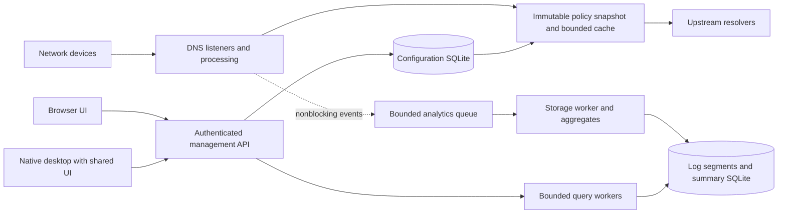

# Product goal: compact DNS protection for desktops and networks

Updated: 2026-11-06. Status: implementation started with tests first. The Rust
policy library, offline compiler, atomic snapshots, CLI, bounded UDP/TCP DNS
forwarding, bounded response caching and performance harnesses are implemented. Encrypted DNS,
database, UI and platform packages remain planned.
See [implementation status and measurements](docs/implementation-status.md) and the
[application task checklist](task.md).

Build a self-hosted DNS filtering application for homes, offices, and companies, with a native desktop application and the same administration interface available in a browser. Prioritize low memory use, low tail latency, small installation size, and reliable operation on modest hardware. Support thousands of devices through a shared network service.

The selected service stack is **Rust + Tokio + Hickory DNS + Axum + SQLite/rusqlite**, with an **FST rule index and Zstandard distribution compression**. The strict size requirement makes the UI selection subject to a compiled feasibility gate: **egui/eframe native + WebAssembly is the first compact candidate**. Tauri/Svelte was investigated, but cannot be treated as meeting an all-in 10 MB limit while excluding its WebView dependencies. Evidence, alternatives, and testing are in [stack-research.md](docs/stack-research.md).

**Hard requirement: the complete installed footprint must remain below 10,000,000 bytes**, including application binaries/assets, additional runtimes, active list/index data, database/WAL, and retained caches. This includes downloaded components. The operating system and stock drivers are the baseline. The [size budget and feasibility plan](docs/size-budget.md) governs all other capacity proposals. No full implementation has yet demonstrated this limit together with the desired feature set, history, and millions of rules. Optimize toward it and report any irreconcilable requirements with measurements; do not silently reduce coverage or exclude dependencies.

Blacklist source research, including forum-discovered multi-million-entry lists, is in [feed-sources.md](docs/feed-sources.md). Verified research downloads are recorded in [feed-snapshot.json](docs/benchmarks/feed-snapshot.json).

A [historical index experiment](docs/benchmarks/index-probe-results.json) has stored 178,507 rules in a 1.84 MB exact searchable FST with warm local lookup p99 around 4.8 microseconds. This is a small research prototype, not the full application or evidence that the complete 10 MB target is achievable.

## 1. Product requirements

- Run continuously as an operating-system service, independently of the desktop window.
- Provide a polished native desktop application on Linux, Windows, and macOS; qualify a UI implementation against the all-in size limit.
- Serve the shared web interface on a configurable management address and port. This is the browser version of the application; a public marketing website is outside this plan.
- Let the desktop application manage the local service or connect to a remote server.
- Support network devices through router/DHCP DNS configuration, without requiring the desktop app on every device.
- Make Arch Linux a first-class packaging and testing target.
- Support detailed DNS analytics, per-device policies, parental controls, and business administration.
- Work without an account, cloud subscription, hosted database, or internet access to the management UI.
- Keep telemetry off by default. List updates and configured upstream resolution are explicit network dependencies.
- Offer resource profiles with explicit cache, log, connection, and storage budgets.

“Thousands of devices” initially means a **5,000-device acceptance workload**, with a **10,000-device stretch workload**. Actual support statements must specify queries per second, protocol mix, list size, logging mode, hardware, and latency. Device count alone is insufficient.

## 2. Similar products and lessons

These are selected capabilities from each project's own documentation, not an exhaustive feature ranking. Missing items in this table do not imply the product lacks them.

| Product | Relevant capabilities | What we should learn |
| --- | --- | --- |
| [AdGuard Home](https://github.com/AdguardTeam/AdGuardHome) | Network filtering, encrypted DNS, client settings, parental filtering, SafeSearch, DHCP, web administration | Convenient setup and understandable filtering controls are baseline expectations. |
| [Pi-hole v6](https://pi-hole.net/blog/2025/02/18/introducing-pi-hole-v6/) | Embedded web server and REST API, HTTPS, subscribed allowlists, consolidated configuration, Basic/Expert settings | A compact integrated dashboard is already established. Avoid comparisons based on its older PHP/lighttpd architecture. |
| [Technitium DNS Server](https://technitium.com/dns/) | Recursive and authoritative DNS, encrypted transports, DNSSEC, DHCP, clustering, role-based access, OIDC/LDAP | Use its business controls as a roadmap reference. Full authoritative DNS is a separate, substantial scope. |
| [Blocky](https://github.com/0xERR0R/blocky) | Go service, group filtering, conditional forwarding, caching, CNAME inspection, metrics, single-binary deployment | Efficient deployment and composable policies are useful foundations. |
| [NextDNS](https://nextdns.io/) | Category and service filtering, recreation schedules, SafeSearch, restricted YouTube, analytics and retention controls | Use its policy workflow as a reference while keeping our service and data self-hosted. |
| [Unbound](https://www.nlnetlabs.nl/projects/unbound/about/) | Validating recursive caching resolver, encrypted DNS and privacy features | Reuse mature DNS components; offer recursion later rather than writing a new recursive resolver. |

Our intended differentiation is the combination of a shared native/web interface, documented resource budgets, explainable policies, local data ownership, and dependable Arch packaging. Whether we outperform existing products must be measured.

## 3. What the product can observe and enforce

| Capability | DNS service alone | Additional requirement or limitation |
| --- | --- | --- |
| Queried domains, record types, outcomes, filtering reasons, upstream latency | Yes, for queries reaching this service | DNS activity is not a complete browsing history. Caches hide some activity. |
| Per-device activity | Usually | Routers that proxy all queries can hide client addresses. DHCP leases, direct client queries, or authenticated enrollment may be needed. |
| Domain/service/category blocking and time schedules | Yes | Cached answers and established connections can continue after a policy changes. |
| SafeSearch and YouTube Restricted Mode | Where the service supports DNS enforcement | These are content restrictions, not complete ad blocking. |
| Remove ads served from the same domain as wanted content | Generally no | A browser/content filter may be needed. [AdGuard documents this DNS limitation](https://adguard-dns.io/kb/adguard-home/faq/#are-there-any-known-limitations). |
| Full URLs, page contents, search terms, process identity, exact screen time | No | Requires endpoint or application instrumentation. |
| Internet upload/download bytes, flows, per-application bandwidth | No | Requires gateway flow data, router integration, or endpoint collection. DNS message bytes must be labeled separately. |
| Prevent all VPN, encrypted-DNS, or direct-IP bypasses | No | Needs router/firewall or managed-device enforcement. Known bypass-domain lists are only partial assistance. |
| Stop an established internet connection immediately | No | Requires a gateway or endpoint control. A DNS “pause” must describe its actual effect. |

Do not present estimated app usage as observed fact. IP/MAC/hostname identity can change or be shared; display identity source and confidence. Remote MAC addresses are not carried in DNS packets.

## 4. Prioritized feature list

P0 is the first usable release, including desktop and browser interfaces. P1 is required before describing the product as ready for general business deployment. P2 is optional advanced scope. Unchecked items are planned, not implemented.

### DNS and reliability

The first bounded UDP/TCP forwarding implementation is available; the combined
requirements below remain incomplete. See [service scope](docs/dns-service.md).

- [ ] **P0** UDP and TCP DNS listeners, IPv4 and IPv6, correct truncation and TCP fallback, EDNS handling, and transparent support for modern record types including HTTPS/SVCB.
- [ ] **P0** Upstreams over UDP/TCP, DoT, and DoH; certificate verification, bootstrap resolution without resolver loops, deadlines, connection reuse, health checks, and failover.
- [ ] **P0** Domain-based conditional forwarding for internal services and split DNS; private names stay with their configured internal resolver.
- [ ] **P0** Local A/AAAA/CNAME/PTR overrides, local names, and configurable block responses.
- [ ] **P0** Bounded positive and negative caching with TTL correctness, policy isolation, and coalescing of identical outstanding upstream requests.
- [ ] **P0** DNSSEC validation through the selected library; explicit valid/bogus/insecure/unchecked states. Locally filtered or rewritten answers must not retain a misleading authenticated-data flag.
- [ ] **P0** Atomic policy/list activation; continue serving the last valid configuration when updates fail.
- [ ] **P0** Resolver access control, per-client and global rate/concurrency limits, malformed-packet handling, and protection against DNS rebinding with explicit internal-network exceptions.
- [ ] **P0** Service health/readiness, graceful shutdown, bounded retry behavior, and clear upstream-outage status.
- [ ] **P1** Downstream DoH/DoT endpoints, certificate lifecycle, and authenticated remote-device profiles where supported by the client protocol.
- [ ] **P1** Opt-in bounded stale serving and prefetch, with correct DNSSEC/TTL handling and visible behavior during outages.
- [ ] **P2** DoQ/HTTP/3, DNSCrypt if demand justifies the dependencies, and optional recursive mode using a maintained resolver.

### Filtering and security policies

- [ ] **P0** Domain and hosts-file blocklists, exact/suffix matching, allowlists, custom rules, and per-device/group assignment.
- [ ] **P0** A documented subset of DNS-relevant Adblock syntax. Report unsupported rules; never imply cosmetic browser-filter compatibility.
- [ ] **P0** Ads, trackers, malware and phishing feed presets; show source, freshness, rule counts, and update failures.
- [ ] **P0** Inspect CNAME chains with bounded depth and cycle handling; apply the same policy to cached answers.
- [ ] **P0** Explain a decision: matched domain, rule, list version, profile, schedule, and override. Include a domain-policy test tool.
- [ ] **P0** Transactional list updates with download/decompression limits, deduplication, validation, ETag support, and rollback.
- [ ] **P0** Temporary allow/block exceptions with expiry, audit entries, and an obvious way to undo mistakes.
- [ ] **P1** Bounded regex rules, service bundles, category feeds, and custom threat feeds with provenance and licensing recorded.
- [ ] **P2** Newly observed-domain and suspicious-query alerts. Label heuristic classifications and false-positive risks; keep expensive analysis off the DNS request path.

Policy resolution must be deterministic: resolver admission rules first; then the selected profile's explicit priority order, including administrator-enforced rules; then scheduled and default rules. Every tie has a documented resolution. A child's temporary exception cannot override an administrator-enforced restriction.

### Our blacklist corpus and update pipeline

- [ ] **P0** Maintain a product-owned source registry and curated additions/exceptions, with categories for ads/tracking, adult content, malware/phishing, gambling, and selectable service restrictions.
- [ ] **P0** Fetch current list files from approved GitHub repositories and other publishers using HTTPS, conditional requests, bounded retries, and update jitter. Never execute source-repository scripts.
- [ ] **P0** Record upstream revision, digest, timestamp, format, declared license, attribution, and source/category provenance. Mixed-source feeds must not be mislabeled as individually classified domains.
- [ ] **P0** Parse, normalize, deduplicate, and validate feed data; preserve exact/suffix/wildcard distinctions and explicit exceptions. Invalid/truncated/empty or suspiciously changed updates cannot replace the working corpus.
- [ ] **P0** Compile immutable compact indexes with category bitsets and shared metadata. DNS matching performs no SQL lookup or text-list scan.
- [ ] **P0** Zstandard-compress published snapshots for transfer/storage. Load a compact searchable index locally; do not decompress an archive per query.
- [ ] **P0** Keep locally curated records with evidence, category, author/reviewer, review date, and expiry where relevant. Provide a false-positive correction and emergency removal workflow.
- [ ] **P1** Publish reproducible, signed compiled snapshots with manifests and rollback history; support on-device compilation for custom sources with explicit resource limits.
- [ ] **P1** Memory-bounded external sorting/merging and staged compilation for large corpora; preserve the previous version during update failure.
- [ ] **P1** Qualify 1-million and 10-million-rule corpora, with a 30-million-rule stress tier. Publish raw entries, unique rules, semantic reductions, index bytes, metadata bytes, build peak, and lookup latency separately.

Do not grow the list solely to advertise a count. Large-corpus mode is required, but its hardware floor is measured separately. Download compression and a compact searchable representation solve different problems; neither justifies promising that tens of millions of rules will fit the small-profile memory budget.

### Parental controls

- [ ] **P0** Child/family/guest profiles, multiple devices per profile, category-based protection using locally downloaded feeds, and per-profile exceptions.
- [ ] **P0** Bedtime and school/work schedules with timezone, daylight-saving, holiday/override, and reboot behavior specified.
- [ ] **P0** SafeSearch and YouTube Restricted Mode controls, with a supported-provider list and diagnostics.
- [ ] **P0** Timed DNS pause, automatic resume, and visible explanation of cached-answer/connection limitations.
- [ ] **P1** App/game/social-service bundles, recreation windows, parent-approved temporary access, and delegated parent permissions.
- [ ] **P1** Enrollment checks and guidance for encrypted-DNS/VPN bypass enforcement through routers or managed devices.
- [ ] **P2** Exact screen-time or traffic quotas only through an optional endpoint/gateway integration; never infer these from query counts.

Category data is a product dependency: evaluate accuracy, update cadence, redistribution rights, download size, and paid-feed costs before advertising coverage. DNS classification cannot determine the contents of individual pages on mixed-content domains.

### Analytics and diagnostics

- [ ] **P0** Overview: QPS, allowed/blocked/error totals, block ratio, cache hit rate, active observed clients, upstream health, and latency percentiles.
- [ ] **P0** Searchable live/history query log with cursor pagination, filters, bounded streaming, and detail inspection.
- [ ] **P0** Query metadata: UTC timestamp, observed client, profile, canonical domain, query type, transport, result code, outcome, reason/rule/list revision, cache status, upstream, total latency, and upstream duration where applicable.
- [ ] **P0** Per-device/profile/domain/upstream views; top domains, blocked domains, query types, trends, and first/last observation within the retained period.
- [ ] **P0** Resource panel: RSS, CPU, cache usage, queue occupancy, dropped log count, ingestion delay, database/WAL size, storage budget, and list-update peak memory.
- [ ] **P0** Minute/hour/day aggregates with explicitly documented dimensions and retention. Distinguish exact totals, sampled records, and approximate rankings.
- [ ] **P0** Logging modes: off, aggregates only, metadata detail, and temporary diagnostic detail. UI clearly shows retention and gaps.
- [ ] **P0** CSV/JSON export, backup/restore, deletion controls, and support bundles with secrets redacted.
- [ ] **P1** Optional answer records/CNAME chain/TTL/validation details with shorter retention and higher resource estimates; never log all raw packets by default.
- [ ] **P1** Alert rules for resolver failures, abnormal request rates, storage pressure, stale feeds, and ingestion loss; authenticated metrics endpoint.
- [ ] **P1** Comparison reports and scheduled local report generation; external notification integrations are opt-in.
- [ ] **P2** Separate network-traffic views sourced from router/flow/endpoint integrations. Show collector coverage and sampling explicitly.

Do not attach arbitrary domains or every client to Prometheus metric labels. Per-client/domain exploration belongs in bounded internal analytics.

### Desktop and browser experience

- [ ] **P0** Shared UI implementation for native desktop and service-hosted browser use; first size-feasibility candidate is egui/eframe compiled natively and to WebAssembly.
- [ ] **P0** Setup wizard: choose local/network service, detect occupied ports, select upstreams/feeds, create administrator credentials, and verify a real query.
- [ ] **P0** Native window, tray/status menu, startup behavior, notifications, and local service status. Closing the window does not stop protection.
- [ ] **P0** Remote server connection management with explicit TLS trust and authentication.
- [ ] **P0** Responsive layouts, keyboard navigation, accessible forms, chart text equivalents, light/dark themes, and reduced-motion support.
- [ ] **P0** Device naming/grouping, policy editor, query explorer, parental schedules, list manager, and diagnostics screens.
- [ ] **P0** Progressive disclosure of advanced settings; explain the consequences of policy changes in user language.
- [ ] **P0** Fully local assets: no CDN fonts/scripts, no analytics beacons, and no runtime Node.js requirement.
- [ ] **P1** Batch operations, localization infrastructure, saved views, and richer server-management workflows.

Desktop and browser users access the same service API and authorization rules. The desktop UI never opens the database directly. Native service installation and OS DNS changes use a narrow privileged helper; the whole UI must not run as administrator. Test native appearance, accessibility, text input, and browser usability before accepting a toolkit solely for its size.

### Business operations

- [ ] **P0** Groups and subnet policies, configuration export/import, versioned REST API, CLI, and recorded configuration changes.
- [ ] **P0** Management binds to loopback initially; deliberate LAN enablement, HTTPS configuration, strong sessions, and no default password.
- [ ] **P1** Admin/operator/read-only roles, scoped API tokens, session revocation, MFA, and auditable policy changes.
- [ ] **P1** OIDC SSO and optional directory integration; DNS device identity remains distinct from an authenticated employee identity.
- [ ] **P1** Two independent resolver nodes with synchronized versioned configuration, drift detection, and tested recovery. Each node has its own databases.
- [ ] **P1** Integration guidance for AD/internal DNS, VLANs, DHCP, IPv6 router advertisements, VPNs, reverse proxies, and firewalls.
- [ ] **P1** Signed releases, upgrade/rollback procedure, migration recovery, and documented maintenance responsibilities.
- [ ] **P2** Multi-site management, central reporting/export, optional DHCP server, and gateway telemetry collectors.

Clients may use either advertised resolver, so both must enforce the same policies. Do not advertise an unfiltered public resolver as the “backup.” Redundancy does not require a shared SQLite file or replicated per-query cache.

## 5. Architecture

The Rust service embeds the browser assets and owns all persistent state. The native desktop contains the shared UI and a small platform adapter. Both are required product surfaces, but server installations can omit the desktop package. Count both artifacts when evaluating the complete distribution. Heavy database reads, list compilation, and exports run outside DNS executor threads with bounded work queues.

## 6. Resource and scale targets

These are **proposed memory/throughput experiments**, not measured results or universal hardware guarantees. The first implementation milestone must reconcile them with the stricter 10 MB total installed-footprint gate. Large corpora and detailed history are not assumed to fit it.

| Profile | Defined test workload | Proposed service budget |
| --- | --- | --- |
| Small network | 100 devices, 100 QPS, 100,000 unique rules, 10,000 cache entries, aggregates-only logging | At most 64 MiB steady RSS and 128 MiB during list replacement; one CPU core; test on a 512 MiB Linux host. |
| Office | 5,000 devices, 2,500 QPS sustained, 10,000 QPS for 60-second bursts, 1 million unique rules, 50,000 cache entries, metadata logging | At most 256 MiB steady service RSS and 512 MiB update peak; baseline on a 1-vCPU/2-GiB Linux VM with local SSD and no swap. |
| Scale stretch | 10,000 devices, 5,000 QPS sustained, 20,000 QPS bursts; separate test of 10,000 encrypted idle connections | Establish measured limits on 2 cores/2–4 GiB. Do not combine this workload with the small-profile promise. |
| Large corpus | 10 million unique rules; 30 million stress case, each under the office traffic mix | Measure on a separate 2–4-GiB reference first; optimize index/metadata storage and report the actual hardware floor. No fixed RAM promise before measurement. |

For cached/blocked UDP/TCP responses on a controlled LAN: target p95 at most 1 ms and p99 at most 5 ms at the office sustained rate. Measure forwarding overhead separately from upstream/network time; target p99 local overhead at most 2 ms. Encrypted-DNS handshake and resumed-connection results get separate budgets after the prototype.

At the sustained acceptance load, require zero incorrect answers or policy leaks, under 0.1% unexpected DNS failures/timeouts, and zero dropped metadata logs when full metadata retention is selected. Overload beyond the tested envelope may shed analytics with visible counters; it must not silently weaken filtering.

The distribution and installed application/data must each stay below **10 MB decimal**. The installed figure includes added runtime dependencies, downloaded lists, active indexes, database/WAL, retained caches, and update staging. Do not count only a small installer or compressed archive. Reserve update space within the same cap or demonstrate an update strategy that preserves correctness without exceeding it. See the allocation experiment in [size-budget.md](docs/size-budget.md).

Desktop RAM is a separate measurement from the 10 MB installed-footprint cap: begin with a 100 MiB idle target and 200 MiB live-chart target, then optimize from measured native/browser builds. Pause hidden-view polling and unnecessary repainting. All added runtime files remain included in the disk-size cap.

Measure whole-machine/cgroup memory as well as service RSS: kernel socket buffers, filesystem cache, and mapped list pages consume real resources. Report CPU, disk writes, database growth, and peak update memory alongside throughput.

Performance tests use fixed resource ceilings. Linux prototype
tests now enforce verified cgroup CPU/RAM budgets with swap disabled; see
[measured budget screens and sustained load](docs/constrained-load-results.md).
The short passing matcher/HTTP screen uses 6 MiB charged memory and 25% of one
logical CPU at 2,500 requests/sec. This is not yet a complete-service budget:
DNS forwarding, cache, analytics, UI and update peaks must be included before
revising the full-product profiles above. Report OOM kills, quota throttling and
dropped arrivals alongside latency; a low memory number without completed work
does not pass acceptance.

## 7. Platform and packaging plan

| Platform | Service | Desktop | Release intent |
| --- | --- | --- | --- |
| Arch Linux x86_64 | Native package + systemd | Native package; Wayland and X11 tested | First development and acceptance target |
| Debian/Ubuntu and Fedora x86_64 | `.deb` / `.rpm` + systemd | Native packages; AppImage secondary | Stable release |
| Linux ARM64 | Native binary/package + service | Native desktop after graphics/toolkit qualification | Stable headless support; desktop qualification separately |
| Windows x86_64 | Windows Service | Signed native installer | Stable release |
| macOS Apple Silicon and Intel | launchd service | Signed/notarized app and installer workflow | Stable release |
| Containers amd64/arm64 | Minimal OCI image with persistent data volume | Browser or remote desktop connection | Stable release; container runtime not required |
| Windows ARM64, FreeBSD, Linux ARMv7/OpenWrt | Qualify toolchain and dependencies first | Varies | Later; do not promise universal support |
| Android/iOS | Network DNS clients | Responsive web administration initially | Native mobile app/endpoint agent is separate scope |

Arch deliverables: source `PKGBUILD`, `.SRCINFO`, optional `-bin` distribution, separate service and desktop subpackages, service user, systemd unit, configuration preservation, completion/man pages, and upgrade/uninstall tests. Follow [Arch's PKGBUILD format](https://man.archlinux.org/man/PKGBUILD.5.en). Publishing to AUR is a release task, not something this plan performs.

Use `/etc/<product>/` for configuration and `/var/lib/<product>/` for mutable system-service data, with platform equivalents elsewhere. Keep desktop preferences in user storage. Package installation must not silently replace the machine's DNS or enable a network listener. The setup flow applies and can restore OS DNS changes deliberately.

Tauri uses system WebView dependencies, including WebKitGTK on Linux. Those dependencies cannot be omitted from this product's all-in accounting merely because they are separately installed. This is why a native toolkit is now the first feasibility candidate. A portable GUI bundle does not itself install a privileged DNS service. [Tauri prerequisites](https://tauri.app/start/prerequisites/).

## 8. Delivery sequence and completion criteria

1. **Size and architecture validation:** build the minimal service, native UI, browser assets, and searchable index; measure the complete footprint and required dependencies first. Test whether the desired corpus and bounded history can fit below 10 MB. Establish protocol correctness, resource measurements, and list-update peaks. Report infeasibility rather than silently dropping requirements.
2. **Vertical slice:** package an Arch service and native window, serve the browser UI, configure an upstream, explain a block, and inspect one logged query end to end. Verify DNS continues after closing the UI.
3. **P0 release:** implement P0 requirements, test parental schedules/cache interactions, backup/restore, failure recovery, and complete the 5,000-device workload with UI and logging active. Qualify Windows/macOS packages before calling the release cross-platform.
4. **Business release:** complete P1 access controls, encrypted client endpoints, redundancy, operational documentation, and extended soak/failure tests.
5. **Advanced scope:** only add P2 features when their dependencies, memory cost, maintenance cost, and user demand justify them.

Release evidence must include reproducible workload definitions, source revision, hardware/OS, list corpus, database size, transport mix, p50/p95/p99, errors, RSS/system memory, ingestion delay/loss, disk growth, and package sizes. Run a 24-hour soak and fault scenarios including upstream outage, disk full, interrupted update, service crash, and restore.

## 9. Decisions still needing product input

- Product name and open-source/commercial license.
- Which category/threat feeds we may redistribute and maintain.
- Default history retention within the proposed disk cap; detailed long-term history costs substantially more storage than aggregates.
- Whether a later network-flow collector is wanted, and which router families to support first.

The service stack is selected for the prototype; UI choice and achievable dataset/history capacity remain subject to the all-in size gate. Implemented dependencies are pinned in Cargo.lock. Performance, size, and compatibility measurements determine whether a selected component needs replacement. The 10 MB cap is not permission to weaken TLS validation, use incorrect probabilistic blocking, or claim retained history that is absent.

## Filter-source controls

- Each source has explicit **Ignore**, **Block**, and **Allow** modes. Ignore
  contributes no policy; Allow creates category-scoped exceptions and does not
  merely disable that source. Keep enforced parental-policy blocks above normal
  allows, with clear explanations of the effective result.
- Show full source URL, actual categories, format, last successful refresh,
  active revision/hash, rule count, unique added domains, overlap, compiled
  bytes, and update errors. Mark bundled base-plus-category feeds distinctly.
- Provide manual refresh and daily scheduled updates with jitter. Desktop users
  can defer automatic updates on battery or metered networks; headless servers
  use their configured schedule without requiring a charging/idle state.
- Before activating a changed source/mode, preview policy and storage effects.
  Warn specifically when allowing a mixed feed would exempt ads/malware or
  other categories beyond its display label. Prefer category-only publisher
  feeds for independently controlled parental categories.
- Compile active sources into one deduplicated exact index; retain bounded
  provenance metadata and respect the complete 10 MB footprint during updates.
  A source toggle can rebuild in the background; activation is atomic and queries
  keep using the last valid snapshot until the replacement is ready.

These are requirements, not implemented UI/updater features. See the
[source-selection design](docs/filter-sources.md).

Disabled sources retain only small catalog/configuration records. Their rule
payloads should be discarded under the strict footprint profile. Re-enabling
requires a fetch/import unless an operator explicitly reserves space for an offline
copy. Rebuild the active union from selected sources; remove only the disabled
source's category/action contributions and preserve rules from other sources.
Never delete a shared hostname merely because one contributing source was
disabled. Removing an allow source can restore blocking and must appear in the
preview. The selection UI/updater and all-disabled service behavior remain
separate from the compiler's nonempty-snapshot contract.
